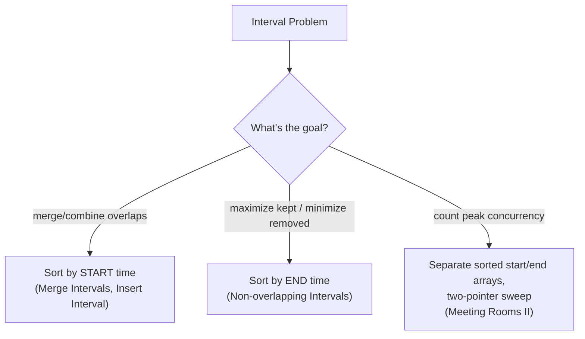

# Module 8 — Sorting & Searching Patterns

## What you'll learn

This module closes out the "foundations" half of the curriculum. It's built around one core idea: **your choice of sort — or whether you need to fully sort at all — changes a problem's complexity class.** A custom comparator can make an otherwise-impossible ordering trivial (Largest Number). Counting sort can beat comparison sort when values are bounded (Custom Sort String, Relative Sort Array). Quickselect and bucket sort can answer "what's at position k" without sorting everything. And interval problems turn all-pairs overlap checks into single linear scans, once sorted correctly.

By the end of this module you will:
- Know when to reach for a custom comparator instead of trying to force natural ordering to work
- Recognize when counting sort or bucket sort beats an O(n log n) comparison sort, because the value range is bounded
- Understand why Meeting Rooms II can't be solved by counting pairwise overlaps — and what "check concurrency at an actual instant in time" means as a correctness principle, not just an optimization
- Have implemented merge sort from scratch, on both an array and a linked list

## Sort by start time vs. sort by end time

The same input intervals get sorted differently depending on what question you're answering — this is worth internalizing as a checklist item before writing any interval-problem code.

## Sub-patterns covered in this module

| Pattern | One-line idea |
|---|---|
| Sort + Linear Merge | Sort by start time, then merge only adjacent overlapping intervals |
| Greedy + Sort (by end time) | Always keep whichever interval finishes earliest, to preserve future options |
| In-Place Merge from the Back | Merge into pre-allocated trailing space without overwriting unprocessed data |
| Quickselect | Reuse quicksort partitioning, recursing into only the half containing the target position |
| Bucket Sort | Sort by a bounded key (frequency, value range) using buckets instead of comparisons |
| Custom Comparator | Replace natural ordering with a problem-specific comparison rule |
| Counting Sort | Skip comparisons entirely when the value range is small and known |

## Problems in this module

| # | Problem | Difficulty | Pattern |
|---|---|---|---|
| 1 | [Merge Intervals](./problems/01-merge-intervals) | Medium | Sort + Linear Merge |
| 2 | [Meeting Rooms](./problems/02-meeting-rooms) | Easy | Sort + Overlap Check |
| 3 | [Insert Interval](./problems/03-insert-interval) | Medium | Linear Scan (Sorted Insert) |
| 4 | [Non-overlapping Intervals](./problems/04-non-overlapping-intervals) | Medium | Greedy + Sort (by end) |
| 5 | [Meeting Rooms II](./problems/05-meeting-rooms-ii) | Medium | Sort + Two-Pointer Sweep |
| 6 | [Merge Sorted Array](./problems/06-merge-sorted-array) | Easy | In-Place Merge from the Back |
| 7 | [Sort an Array](./problems/07-sort-an-array) | Medium | Merge Sort (from scratch) |
| 8 | [Kth Largest Element in an Array](./problems/08-kth-largest-element) | Medium | Quickselect |
| 9 | [Top K Frequent Elements](./problems/09-top-k-frequent-elements) | Medium | Bucket Sort |
| 10 | [Largest Number](./problems/10-largest-number) | Medium | Custom Comparator |
| 11 | [H-Index](./problems/11-h-index) | Medium | Sort + Linear Scan |
| 12 | [Custom Sort String](./problems/12-custom-sort-string) | Medium | Counting + Custom Order |
| 13 | [Relative Sort Array](./problems/13-relative-sort-array) | Easy | Counting Sort |
| 14 | [Kth Smallest Element in a Sorted Matrix](./problems/14-kth-smallest-in-sorted-matrix) | Medium | Binary Search on Value + Counting |
| 15 | [Sort List](./problems/15-sort-list) | Medium | Merge Sort on a Linked List |

**Suggested order:** top to bottom. Problems 1–5 build the interval-sorting toolkit. 6–9 cover in-place merging and "don't fully sort" techniques (quickselect, bucket sort). 10–13 focus on custom orderings and counting sort. 14–15 close by combining sorting concepts with binary search and linked lists, bridging back to earlier modules.

## Up next

**Module 9 — Hashing.** The deep dive that Module 1 only previewed: frequency maps, grouping by derived keys, and the prefix-sum + hashmap combo that solves a huge chunk of "subarray sum" problems in O(n).
